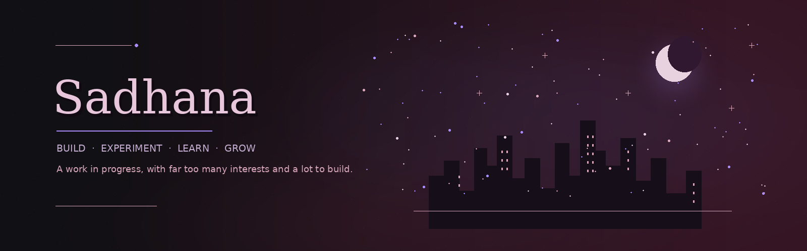

<!-- Sadhana's GitHub profile README | premium plum / oxblood palette -->

  

  

<em>Curious by nature. A work in progress by choice.</em>

  <a href="https://evolvenowv2.vercel.app/">Evolve Now</a> &nbsp;·&nbsp;
  <a href="https://synaptic-eight.vercel.app/">Synaptic</a> &nbsp;·&nbsp;
  <a href="https://github.com/Sadh-ana/PlayWorlds">PlayWorlds</a>

---

### ✦ A little about me

I'm Sadhana — a curious builder who likes exploring ideas across technology, AI, games, and creative projects. I enjoy turning “what if?” into something real, learning as I go, and making things that feel thoughtful as well as useful.

### ⟡ Selected work

<table>
  <tr>
    <td width="50%" valign="top">
      
      <strong><a href="https://evolvenowv2.vercel.app/">Evolve Now ↗</a></strong> 
      A personal growth and planning project.
    </td>
    <td width="50%" valign="top">
      
      <strong><a href="https://synaptic-eight.vercel.app/">Synaptic ↗</a></strong> 
      A visual space for connecting ideas and organizing knowledge.
    </td>
  </tr>
  <tr>
    <td colspan="2" align="center">
       
      <strong><a href="https://github.com/Sadh-ana/PlayWorlds">PlayWorlds ↗</a></strong> 
      A game development project exploring interactive worlds and gameplay.
    </td>
  </tr>
</table>

<em>Project images are concept artwork, not screenshots of the live products.</em>

### ⌘ Tools & technologies

  
  
  
  
  

### ☾ The developer corner

  
  &nbsp;
  

  Small steps, consistent curiosity.

---

<em>Not a finished product. Always becoming.</em> <strong>Same soul. Bigger dreams.</strong>

